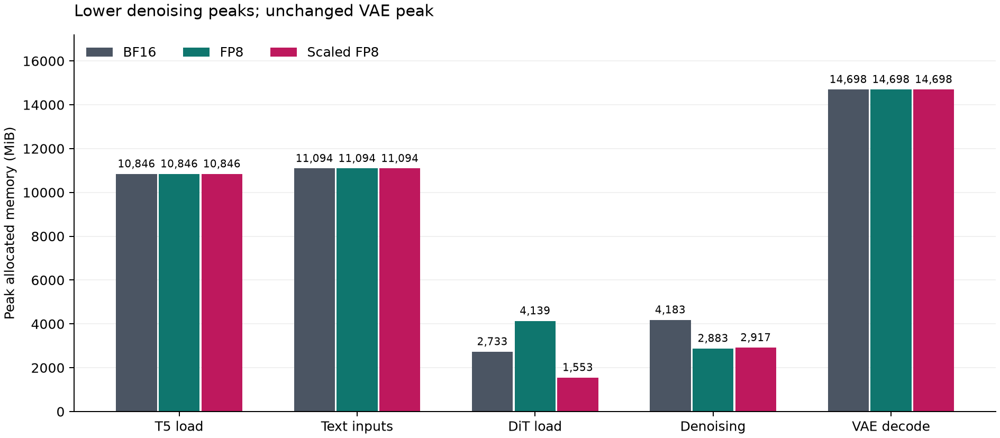

# 延迟、显存与质量权衡表 v1

日期：2026-11-06，Asia/Shanghai。仅覆盖Wan2.1 T2V 1.3B、480×832、81帧、16fps、20步。
未启用fp8_fast、compile、block swap、FP8 T5或组合优化。

| 配置 | 同环境基线 | 端到端耗时变化 | 5%速度门槛 | 去噪allocated峰值MiB | 整次allocated峰值MiB | 质量/生成 | 综合分类 |
|---|---|---:|---|---:|---:|---|---|
| 主环境BF16 | 自身参照 | 0 | 参照 | 4183.47 | 14698.35 | 36段参照 | 参照 |
| SageAttention | 副本A1 torch | −7.9798% | 达到，范围不重叠 | 4183.45 | 14698.35 | 三维数值计数达标；36/36 | 结论不足：关键观看/会话记录不完整 |
| 普通FP8 | 主环境F0+F3 | −1.2649% | 未达到 | 2882.59 | 14698.35 | 三维均有明确填写的明显退化；36/36 | 不推荐（当前任务/目标） |
| scaled FP8 | 主环境F0+F3 | +0.4582% | 未达到 | 2917.08 | 14698.35 | 时序、符合度有明确填写的明显退化；36/36 | 不推荐（当前任务/目标） |

速度仅覆盖P01/s42；质量覆盖P01–P12各三个种子。Sage与FP8来自不同环境，
只比较各自组内变化率，不能按跨环境绝对秒数排名。
“明显退化”为保留的评分者方向/程度判断，部分维度证据不完整，助手未独立复看。
缺失程度和观看元数据均保留，三种质量维度不合成为总分。

## 阶段显存

单位均为MiB，各阶段独立峰值，不能相加。F6/F7/F8和A4均为一次正式阶段诊断，
不是多轮平均；不同时间的峰值差不等于可同时回收的空间。

| 阶段 | 主环境BF16 | 普通FP8 | scaled FP8 | Sage副本A4（独立环境） |
|---|---:|---:|---:|---:|
| T5 load | 10845.60 | 10845.60 | 10845.60 | 10845.60 |
| Text inputs | 11093.61 | 11093.61 | 11093.61 | 11093.61 |
| DiT load | 2732.65 | 4139.42 | 1553.22 | 2732.65 |
| Denoising | 4183.47 | 2882.59 | 2917.08 | 4183.45 |
| VAE decode | 14698.35 | 14698.35 | 14698.35 | 14698.35 |

去噪阶段普通/scaled分别下降31.10%/30.27%，但整次峰值仍在VAE解码，约14698 MiB
（14.35 GiB，不是14.7 GiB）；文本输入阶段约11094 MiB（10.83 GiB）。
不能将阶段收益外推为当前整次省显存、更大batch、更长视频或避免OOM。
D4=A允许描述有条件阶段收益，但两个FP8已有负面质量记录，不能据此归为有条件可用。

## 机理与失效条件

| 配置 | 实际机制 | 本次局限/失效条件 |
|---|---|---|
| Sage | 替换attention为实际执行过的sageattn_varlen Triton路径 | 依赖编译与兼容版本；仅验证当前Ada环境；不是权重FP8；关键质量记录不完整 |
| 普通FP8 | DiT权重直接FP8存储，标准Linear/BF16 autocast | 加载峰值反升51.48%，原因未定位；本次未达速度/质量门槛 |
| scaled FP8 | 目标Linear权重FP8+scale，显式反量化后F.linear | fp8_fast=false，不能称硬件FP8乘法加速；本次未达速度/质量门槛 |

Day7 的[分配历史分析](week5_vae_peak.md)已定位峰值最大分配为 native slow 3D 卷积的
columns 临时缓冲区，requested 7897.5 MiB；缓存成员按生命周期和源码顺序重建为
3556.083984375 MiB。上图仍仅为阶段峰值，不承担内部归属证明。
本周未执行VAE算法改动，也未验证任何组合配置。

## VAE 单输入诊断补充

以下是 P01/s42 latent-only、新进程、无探针、各一次的诊断，与主表正式端到端候选分开；
不能用于重判 Week4，也不能把 VAE 区间变化写为完整生成收益。

| 配置 | VAE 区间秒数 | allocated 峰值 MiB | reserved 峰值 MiB | 输出核验 |
|---|---:|---:|---:|---|
| 原版 GPU 缓存 | 10.993825 | 14698.970703125 | 18674 | 基线视频 |
| 现有 `vae_cache_cpu` | 50.383250 | 11142.07421875 | 16078 | 81 帧完整解码，MP4/RGB 摘要与基线相同 |

allocated 降低 24.198269%，reserved 减少 2596 MiB；单次耗时为 4.582868 倍。
降幅与重建缓存占用相差 0.8125 MiB，作为交叉验证线索；CPU-cache 峰值位置未采 history。
原始浮点输出张量未保存比对，视频相同不证明 raw tensor 完全相等。
结论是该输入下显存与时间的明显权衡，不是正式速度、质量门槛或 16G 可用性验收。
原件/身份与完整解码审计见 [cache CPU audit](week5/vae-cache-cpu-01-local-audit.json)。

## 证据

- [Sage v2](week5_result_attention_v2.md)、[普通FP8](week5_result_fp8.md)、[scaled FP8](week5_result_fp8_scaled.md)
- [人工质量汇总](week5_quality_summary.md)、[回收与澄清](week5_rating_review.md)
- `notes/week4/fp8_total_audit.json`、`fp8_stages_audit.json`；`notes/week4/A1_audit.json`至`A4_audit.json`
- 图的原始数值：`notes/week5_figures/stage_allocated_peaks.csv`。
