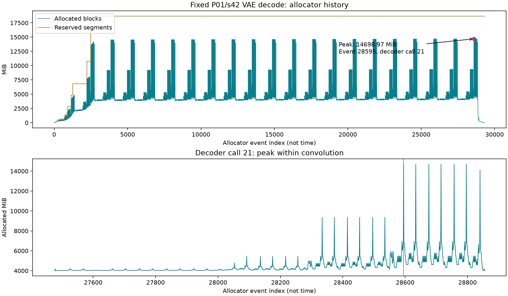

## Material Passport

- Origin Skill: academic-research-suite / experiment-agent
- Origin Mode: validate
- Origin Date: 2026-11-06
- Verification Status: ANALYZED
- Version Label: week5_vae_peak_final_v4

## 当前状态

公开归档说明：原始运行 JSON、精简审计、峰值/缓存表和静态曲线已公开，见 [Week5 归档](WEEK5_ARCHIVE.md)。完整 pickle、逐事件时间线 CSV、内嵌快照 HTML、用户截图、媒体及第三方源码副本保留本地。以下历史验收描述不表示这些原件也已分发。

**峰值的主要分配来源已定位：第 21 次 decoder 调用内，native `slow_conv_dilated3d` 的 columns 临时缓冲区申请 7897.5 MiB，占当时 allocated 峰值约 53.73%。** 不是开头的 conv2 或末尾输出拼接触发峰值。按分配生命周期和源码赋值顺序重建，峰值时 `_feat_map` 已赋值缓存的底层 storage 合计 3556.083984375 MiB，另有尚未替换旧值的新缓存副本 292.5 MiB。

原件、快照及视频已在本机验收；逐事件重建的 allocated/reserved 峰值与服务器记录逐字节相同。`vae_cache_cpu` 同输入对照原件亦已验收：allocated 峰值减少 24.198269%，单次区间耗时为 4.582868 倍，MP4 和解码后 RGB 帧摘要与基线相同。用户已回传 memory viz 正常渲染与选中分配栈的截图，原图已归档。**Week5 定位测量及文档收尾完成**，后端为什么选择 slow 路径尚未测明；未实施性能改法。

## 已核验的范围

| 项目 | 结果 |
|---|---|
| 固定输入 | P01/s42，FP32 `[16,21,60,104]`，finite=true，哈希/metadata 匹配 |
| 环境 | 服务器主环境 torch 2.9.1+cu128、CUDA build 12.8，物理 GPU0，固定上游 commit |
| VAE | BF16，cache_cpu=false，未改数值代码 |
| 单次仅解码 | 10.993825 秒，包含 VAE 加载、GPU 传输及 FP32/CPU 转换；不含 MP4 编码，无预热 |
| allocated / reserved | 14698.970703125 / 18674 MiB，当前进程 allocator 绝对峰值 |
| 与旧基线 VAE 峰值之差 | allocated +0.6171875 MiB（+0.004199%）；reserved +8 MiB |
| 本机 MP4 验收 | 81 帧、832×480、16 fps、H.264/yuv420p、无全黑帧，完整解码成功 |
| 输出身份 | MP4 与冻结基线 P01/s42 的 SHA256 完全相同 |

峰值接近支持继续仅解码诊断，不证明相同内部峰值成因；跨上下文的秒数不作速度收益比较。该输出字节一致只描述一个固定输入，不外推三候选质量、全部视频或未来改法的误差。

## 原件与来源

本机原件目录：`outputs/week5-vae/decode-baseline-01/`，含 input.json、result.json 与 MP4。
本机审计：[vae-baseline-01-local-audit.json](week5/vae-baseline-01-local-audit.json)。
测量与验收入口为 `scripts/vae_decode_measure.py`、`scripts/audit_vae_decode.py`。

服务器 GPU 运行由用户完成，原始记录回传后由本机独立复算字段、哈希并完整解码；不是助手独立重跑 GPU 实验。latent/VAE 权重未传回，不声称本机独立验过其内容。

源码身份以服务器原始哈希与固定 Git blob 对照。本机工作树为 CRLF，服务器/固定 blob 为 LF；换行归一后本机源码与 blob 完全一致，原始字节不同如实记录，未修改上游。首次本机审计因此中止，校正核验对象后完成，未覆盖输入或产生早期成功审计。

## 三个问题的当前答案

| 问题 | 当前证据 |
|---|---|
| 峰值时哪些分配最大，具体形状是什么 | 最大块是 native slow 3D 卷积的 columns 临时缓冲区；大分配表见下。缓存形状来自 hook，临时张量形状为源码/字节数一致的重建，未直接 hook |
| 是 conv2、逐片 decoder 中间激活还是输出 cat | 第 21 次逐片 decoder 内部卷积；分配栈 `vae.py:38 → 209 → 453 → 586`。触发峰值的是 columns 分配，不是 `vae.py:587` 的输出 cat |
| 峰值瞬间 feat_cache 占多少 | 生命周期与赋值顺序重建为 3556.083984375 MiB；另有 292.5 MiB pending clone，不计为已经赋值的 `_feat_map`。CPU 缓存对照减少 3556.896484375 MiB，量级交叉一致 |

新探针 `scripts/vae_memory_probe.py` 已通过本机 dry-run 和模拟检查，用户已回传运行末尾 PROBE_SUMMARY。它复用基础入口、开启 allocator 分配历史，并保存 conv2/decoder 边界形状及按底层 storage 去重的缓存字节；结果不能超出观察精度。操作见 [预检第四步](week5_vae_preflight.md)。

## 快照生成摘要回收

用户报告快照 7781984 字节（约 7.42 MiB），SHA256 `c8682923be50a74c6884acc3e5bc1bdf5443ae33c364763092a9ceecbdd62b63`。GPU0 历史 29327 条，37 个 segment_alloc、9764 个 alloc、9763 个 free_requested 和 9763 个 free_completed；低于 200000 条上限，摘要的截断标志为 false。21 次 decoder 调用、44 个边界记录符合预期。

摘要另存 [用户快照摘要](week5/vae-history-01-user-summary.json)，随后传回的原件已独立核对，大小/哈希/事件及边界计数全部一致。事件计数本身不说明峰值由哪种张量造成，不据分配/释放数量之差断言泄漏。

## 原件验收与历史重放

原件位于 `outputs/week5-vae/history-baseline-01/`。本机分析入口为 `scripts/analyze_vae_history.py`，机器审计为 [audit.json](week5/vae-history-01-analysis-v2/audit.json)，归属复核为 [attribution.json](week5/vae-history-01-analysis-v2/attribution.json)。

- input/result/probe 交叉一致，status=ok；基础脚本、探针、基线 result、固定 Git blob、输入与模型身份记录均匹配，history_started/stopped 均为 true。
- 探针运行 10.147731060991646 秒、allocated 14698.970703125 MiB、reserved 18674 MiB；两种峰值与无探针基线相同。单次带探针耗时不作速度结论。
- MP4 SHA256 与无探针及冻结 P01/s42 基线相同；完整解码 81 帧、832×480、16 fps、H.264/yuv420p，无全黑帧。RGB 帧摘要同基线：`da2563fa1f9f5ce76a025429e54315f65ceb0757c60fff8854d27217ad1f4a6d`。
- 历史从 allocated=0 开始，无截断迹象。分析支持本次默认 native allocator、单流、非 expandable 配置；按 512 字节舍入、small/large 池拆分及同 segment 空闲块合并规则回放。每个最终 block 的地址/大小/状态、末尾 allocated/active/reserved 均与快照相符。
- 峰值为事件 **28595**，242 个存活分配，allocated **15412987904** 字节，requested **15410126406** 字节，差额 **2861498 字节 / 2.728937149 MiB** 是块内舍入/未拆分余量。不能把 trace 中 requested size 之和冒充 `max_memory_allocated()`。
- 44 个 hook 记录都与历史 allocated/reserved/max 和每个观测 storage 的分配生命周期对应。第 21 次 decoder 的入口在事件 27475–27481，出口在 28849–28855；峰值位于其内部。

## 峰值时的大分配

以下是**同一峰值时刻存活的分配**，不是“历次最大申请”排名；完整 242 项见 [CSV](week5/vae-history-01-analysis-v2/peak_live_allocations.csv)。MiB 为 requested 字节，allocator block 大小另列于 CSV。缓存汇总与其中逐项分配有重叠，不另加到总峰值。

| 分配事件 | 用途与证据 | requested MiB | 形状与精度 |
|---|---|---:|---|
| 28595 | native `slow_conv_dilated_all_cuda_template<3>` 中 columns resize，`vae.py:38/209/453/586` | 7897.5，block 为 7898 | 重建 `[2592,1597440]` BF16，即 `[96×27,4×480×832]`；不是内部 hook 直接观测 |
| 28590 | `CausalConv3d` 的 `F.pad`，`vae.py:36` | 883.274414 | 重建 `[1,96,6,482,834]` FP32，字节数和显式 padding 一致 |
| 28585 | residual 内的层输出，`vae.py:213` | 585 | 重建 `[1,96,4,480,832]` FP32；具体层身份未单独 hook |
| 28593 | conv3d autocast 的 `_to_copy` 输入副本，`vae.py:38` | 441.637207 | 重建为上述 padded 输入的 BF16 副本 |
| 多项 | 7 个峰值前已有的全分辨率缓存，索引 25–31 | 每项 292.5 | hook 直接观测 `[1,96,2,480,832]` FP32，并用地址及 allocation epoch 对应 |
| 28588 | 本次卷积前产生、尚未写回 `_feat_map[25]` 的新缓存 clone，`vae.py:205` | 292.5 | 出口 hook 观测相同 storage 的 `[1,96,2,480,832]` FP32 |
| 28594 | slow conv 的输出分配 | 292.5 | 重建 `[1,96,4,480,832]` BF16 |
| 27479 | 上一轮 `torch.cat` 保留的累积视频，`vae.py:587` | 175.957031 | 重建 `[1,3,77,480,832]` BF16 |

PyTorch **v2.9.1** 的 `aten/src/ATen/native/cuda/NaiveDilatedConvolution.cu:195–209` 使用 input.options 创建 columns，并 resize 到 `[nInputPlane × kernel_volume, output_volume]`。最大分配的 native 栈直接包含该函数，大小等于 `2592×1597440×2`，下一条事件 28596 就申请释放；因此可归属为展开用 columns 临时缓冲区，不能称为 cuDNN workspace。重建形状仍与直接观测区分。

两个对应版本的原始 C++ 文件已保存于本地分析目录，公开保留 URL/哈希，见 attribution.json。具体 backend 选择原因未记录，不据函数名推断 cuDNN 禁用、BF16 不支持或未来更换后端必然有效。

## 缓存生命周期重建

单用 decoder 入口或出口的 3556.083984375 MiB，原本不能回答峰值瞬间问题。本次将 storage 地址与**allocation event** 一起对应，避免复用地址造成误认，再结合 `ResidualBlock.forward` 的赋值顺序：

1. `vae.py:205` 创建新 `cache_x`；
2. `vae.py:209` 用旧 `feat_cache[idx]` 执行当前卷积；
3. `vae.py:210` 仅在卷积返回后将新值写回。

峰值发生在索引 25 对应卷积内部。索引 0–24 的新 storage 已替换旧值，25–31 的旧 storage 仍然存活；索引 25 的新 clone（事件 28588）也已存活，但旧值直到事件 28604 才释放。由此重建：

| 归属 | 字节 | MiB |
|---|---:|---:|
| 已赋值 `_feat_map`，32 个去重 storage | 3728824320 | 3556.083984375 |
| 尚未赋值的新缓存副本 | 306708480 | 292.5 |
| 前后边界观测过且峰值仍存活的 storage 并集 | 4035532800 | 3848.583984375 |

这是**生命周期加源码赋值顺序重建**，没有声称在峰值内部直接运行了缓存 hook。详见 [cache_epochs.json](week5/vae-history-01-analysis-v2/cache_epochs.json) 和 attribution.json。数据是 storage 请求字节，不是 allocator 块或整卡占用。CPU offload 可能改变临时副本、传输和重叠，不能从 14698.97 直接减 3556.08 来预测实测峰值。

## 可视化验收

上图横轴是事件序号，不是 GPU 时间；下图展开第 21 次 decoder。原始 时间线 CSV（本地附件未随公开快照发布） 和 [边界 CSV](week5/vae-history-01-analysis-v2/checkpoints.csv) 可复算。周期性大峰在多次 decoder 中重复，最后一次因存活集合变化达到全局最高；不把一次峰值误解为只有最后一片才分配 columns。

已生成 PyTorch memory_viz.html（本地附件未随公开快照发布）。该文件含本地快照，JavaScript 依赖外部 PyTorch CDN，不能称离线独立 HTML。工具浏览器曾拒绝 `file:` 协议，助手没有绕过策略。随后用户在本机浏览器打开并回传下图，完成用户侧交互查看及截图回收。

用户回传的 PyTorch memory viz（本地附件未随公开快照发布）

截图显示 `snapshot.pickle`、`Active Memory Timeline`、设备 0，`Detail: 9764 of 9764 entries`，时间线正常渲染，数量与已审计快照 alloc 记录一致。底部是一个 **292.5 MiB / 306708480 字节**选中分配及调用栈，**不是**全局峰值的 7897.5 MiB 最大分配。截图仅作为查看/渲染证据；精确峰值、最大分配和缓存归属仍以独立快照重放及源码审计为依据，不从图中读取或反推。

截图原字节另存 `memory_viz-user-timeline.png`（305377 字节），SHA256 为 `4d4ac320b02198decd7131266ab1111e0aad921c162e23cc42814d0477d8e15c`，复制前后相同；来源和观察边界见 截图记录（本地附件未随公开快照发布）。标签和截图本身不独立证明页面所载快照的字节身份，不声称助手操控过用户浏览器。

首次本机分析在成功生成 JSON/CSV/HTML 后，绘图因 Python 3.11 与独立 cache 中 cp312 的 matplotlib 不匹配而中止；该部分目录 `vae-history-01-analysis/` 保留，不作为最终入口。拆分纯分析和绘图后，`vae-history-01-analysis-v2/` 分析完整成功，绘图用既有 bundled Python 3.12 独立环境，未修改推理环境。

同输入基础脚本加 `--vae-cache-cpu` 的 fresh-process 对照已完成并验收，见下节。无探针对无探针，单次耗时只作诊断，不作未来性能规则 v2 的正式速度验收。本轮无需重跑，可视化截图亦已回收。

## 对后续选题的约束

当前优先调查方向是 native slow 卷积的 columns 展开和后端选择。输出 cat 在这一峰值中的累积输出仅约 175.96 MiB，单改该部分不能解释或直接消除 7897.5 MiB 的 columns 申请。CPU 缓存对照已验证这一个输入的显存/时间代价，尚未验证分块、后端替换或与其他候选组合的速度、原始浮点张量误差和整次收益；不能把单块体积等同于可实现降幅。第 6–7 周正式选题和预登记尚未进行。

## CPU 缓存同输入对照（原件验收完成）

用户先回传部分 stdout，保存于 [用户摘要](week5/vae-cache-cpu-01-user-summary.json)，该历史片段未包含 status 字段。随后整个 `outputs/week5-vae/decode-cache-cpu-01/` 已传回，经独立入口 `scripts/audit_vae_cache_cpu.py` 核验通过；机器记录见 [本机审计](week5/vae-cache-cpu-01-local-audit.json)。

| 指标 | 原版无探针基线 | CPU 缓存原件 | 本机复算差值 |
|---|---:|---:|---:|
| allocated 峰值 MiB | 14698.970703125 | 11142.07421875 | 减少 3556.896484375（24.198269%） |
| reserved 峰值 MiB | 18674 | 16078 | 减少 2596 |
| 单次解码区间秒数 | 10.99382509899442 | 50.383249560996774 | 增加 39.389424462，耗时为 4.582868 倍 |

本次降幅与 history 中重建的已赋值缓存 3556.083984375 MiB 相差 0.8125 MiB，量级接近，作为交叉验证线索保留。没有 CPU-cache history，不声称其峰值仍发生在相同事件、剩余最大块完全相同，或差额均由缓存唯一解释。耗时差为单次 fresh-process 诊断，不是正式速度验收；这是同输入 VAE 区间，不是完整生成性能。

原件验收结果：

- input 的 running/空 decode 记录与最终 status=ok 对应；`vae_cache_cpu=true`、`memory_history=false`、GPU0、无预热、单次诊断。与基线的上游参数除输出目录外只多 `--vae_cache_cpu`，输入、模型、环境和源码记录均一致。
- 基础脚本哈希不变，两个服务器源码哈希与固定 Git blob 相同，本机工作树仍仅 CRLF 差异；之前基线审计记录过的原始文件哈希未变。
- 完整解码 81 帧、832×480、16 fps、H.264/yuv420p，无全黑帧。MP4 SHA256 为 `fa59fbd653bef48711826054cbfc3463da9003b10c429c2273d9cf77eb838217`，与无探针基线和冻结原 P01/s42 视频完全相同；RGB 帧摘要也相同。
- 编码视频及 RGB 帧相同不证明 VAE 原始浮点输出张量逐元素相等，本次未保存该张量作误差审计。latent/VAE 本体未传回，身份仍以服务器记录核对；没有独立 GPU 重跑。

本周对照结论是：**现有 CPU 缓存开关在固定任务的 VAE 解码区间降低约 24.20% allocated 峰值，同时该次解码耗时由 10.99 秒变为 50.38 秒。** 可作为显存与时间权衡的诊断证据，不能外推为正式速度比、完整生成已省 24.20% 显存、16G 可用或对所有输入无损。缓存降幅与重建占用接近支持归属分析，但 CPU-cache 剩余峰值具体位置未测。

memory viz 查看/截图随后已回收，见上节。Week5 规定的测量、分析和证据归档完成；后续仅在第 6–7 周单独预登记后调查后端选择或实施候选改法，不追加本轮 GPU 测量。

## 方法检查

覆盖 11/11；本阶段没有 p 值、显著性检验或总体等价性结论。

| 检查 | 级别 | 当前约束 |
|---|---|---|
| Simpson's paradox | NOTE | 单固定输入，无跨组总平均或排名 |
| Ecological fallacy | CAUTION | 不从一个输入推广其他提示词或硬件 |
| Berkson's paradox | CAUTION | 固定 P01 诊断，不是总体随机抽样 |
| Collider bias | NOTE | 未拟合协变量或按结果筛样本 |
| Base rate neglect | NOTE | 非诊断准确率研究，不用单次成功估计总体成功率 |
| Regression to the mean | NOTE | 未按异常大峰值挑选输入，不称后测下降为优化效果 |
| Survivorship bias | CAUTION | 保留所有本轮记录；单次成功不证明全任务可靠性 |
| Look-elsewhere effect | NOTE | 内部来源问题预先列明，不根据漂亮图事后改收益阈值 |
| Garden of forking paths | CAUTION | 固定输入与原记录保留，新增探针单独版本及目录 |
| Correlation versus causation | CAUTION | 归属来自分配栈及生命周期；CPU 缓存对照已验收，但未记录其峰值位置，不能用差额解释每个分配 |
| Reverse causality | NOTE | 没有观察性回归因果推断或反向因果结论 |

本机验收与历史分析为 ANALYZED，不等于独立 GPU 重跑。峰值来源已有栈证据，临时形状与缓存成员为明确标注的重建，CPU 缓存对照及用户可视化截图已验收；未来改法的收益尚未验证。
